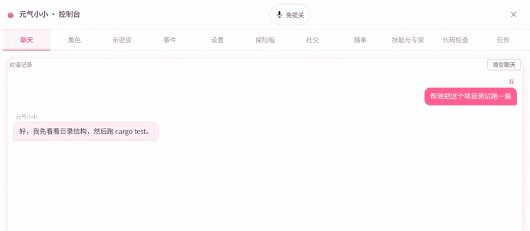
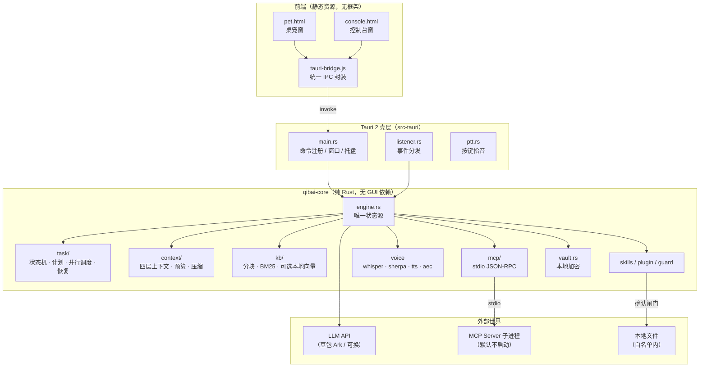
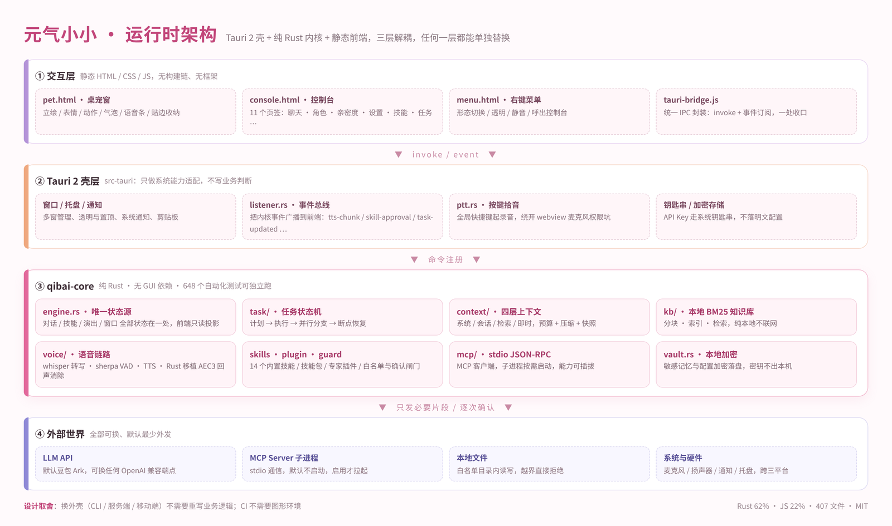
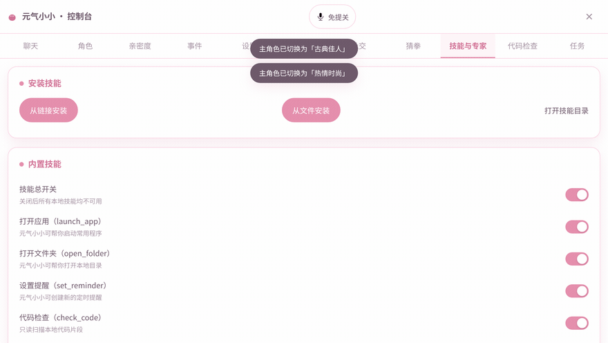
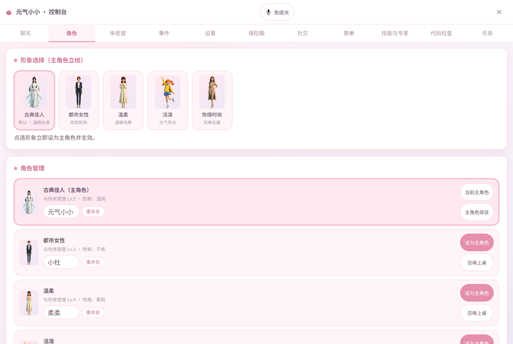
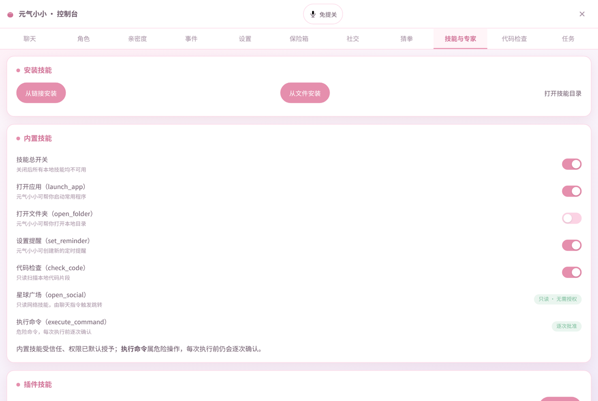
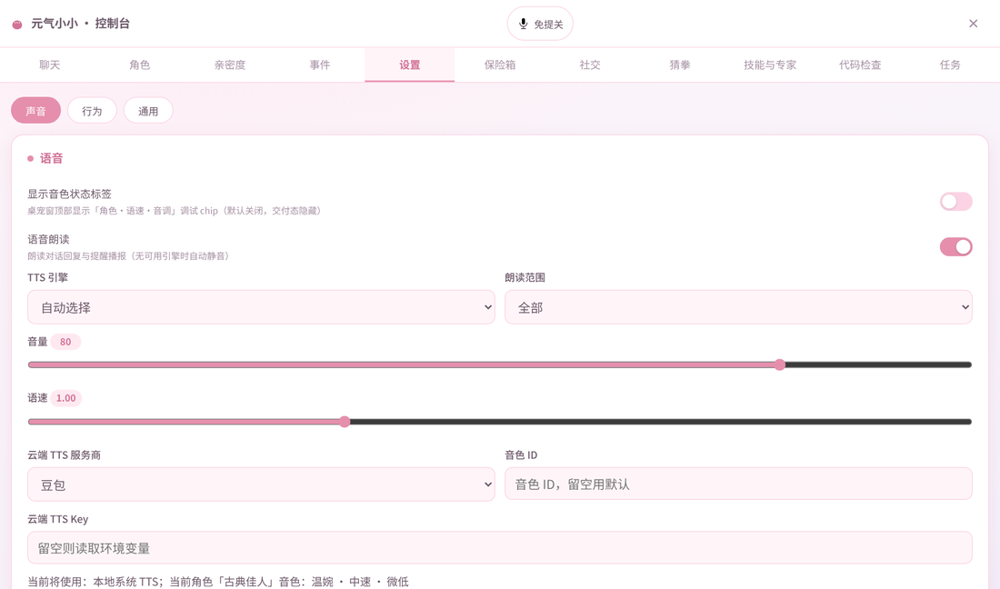

<div align="center">

# 元气小小 · Qibai

**住在你桌面角落的 AI 伴侣：会聊天、会记事、能动手的本地优先桌面 AI**

桌宠窗 + 控制台窗 ｜ Tauri 2 + 纯 Rust 核心 ｜ Windows / macOS / Linux

[](LICENSE)
[](https://tauri.app)
[](https://www.rust-lang.org)
[](#快速开始)
[](https://github.com/AllenD87/qibai/actions/workflows/ci.yml)

<br/>



<br/>
<sub><b>界面实录</b>：真实前端页面渲染录制 —— 聊天 / 角色 / 亲密度 / 事件 / 设置 / 技能与专家 / 代码检查 / 任务，点开就是真界面</sub>

</div>

---

## 这是什么

元气小小（内部代号 **Qibai**）是一个**住在桌面角落的 AI 伴侣**——一个会聊天、会记事、**真能动手**的小人。

说一句「小小」，它开始听你说话；说一句「帮我把这个项目跑起来」，它真的会建目录、写 README、跑测试；你埋头干活忘了喝水，它会自己冒出来提醒你。

它不是「聊天窗口换个皮肤」，也不是「把 API 包一层弹窗」的 AI 收纳盒。


<div align="center">
<b>会聊天 · 听得懂 · 记得住 · 真动手</b>
</div>

---

## 三个亮点，30 秒看懂

| 会聊天：一个有状态的桌宠 | 听得懂：语音是真的本地跑 | 真动手：能替你把活干完 |
|---|---|---|
| 5 个角色各有形象、性格、亲密度与音色<br>表情/动作由 LLM 的结构化输出驱动<br>久坐、喝水、护眼主动提醒<br>说累了还能来一局猜拳 | 本地 whisper 转写，音频不出本机<br>喊「小小」进免提，VAD 自动断句<br>**支持双工打断**：它说话时你能插话<br>Rust 移植 AEC3，它听不到自己 | **14 个内置技能**：建工程、读写文件、跑测试、查代码、搜索、抓网页、开应用<br>技能包 / 专家插件 / MCP / HTTP 连接器都能接<br>**危险操作逐次确认**，不确认就不执行 |

---

## 30 秒看懂：你说什么，它做什么

| 你说 | 它做 |
|---|---|
| 「小小」 | 进入免提聆听，VAD 自动断句，说完直接回你 |
| 「这个项目测试跑过了吗」 | 调 `git_status` / `run_tests` / `code_scan`，把真实结果念给你 |
| 「建一个 Rust 项目，叫 demo」 | `create_project`：目录骨架 + README + `.gitignore` + `PROJECT.md`，可选 `git init` |
| 「这段代码有什么问题」 | `check_code` 只读分析，给**文件名 + 行号 + 问题 + 修复建议** |
| 「帮我搜一下 Tauri 2 的托盘 API」 | `web_search` 找、`fetch_page` 读全文，基于真实页面回答 |
| 「提醒我十分钟后喝水」 | `set_reminder`，到点系统通知 + 桌宠气泡 + 语音 |
| 「我有点累了」 | 切表情与动作，必要时拉全屏守护演出陪你歇一会儿 |
| 「把这份配置存到文档里」 | `file_ops` 写文件，但只允许 `~/Documents/qibai` 之内，越界**直接拒绝** |

### 能力总览：六件事，一件都没省

| 能力 | 具体是什么 | 详见 |
|---|---|---|
| **陪** | 5 个角色（形象 / 性格 / 音色 / 亲密度各自独立）＋ 表情动作演出 ＋ 久坐·喝水·护眼主动提醒 ＋ 猜拳小游戏 ＋ 全屏守护演出 | 功能详解 · 一 |
| **说** | 全局快捷键按住说话 → 本地 whisper 转写 → 流式回复 → 分段朗读；喊「小小」进免提，VAD 自动断句；**双工打断**（barge-in）随时插话 | 功能详解 · 二 |
| **做** | 14 个内置技能：建工程、读写文件、跑测试、查代码、搜索、抓网页、开应用、设提醒……全部可在控制台逐项开关 | 功能详解 · 三 |
| **接** | 技能包（打包 / 导入 / 安装）、专家插件、MCP Server（stdio）、HTTP 连接器，运行时装、不用改主程序 | 功能详解 · 三 |
| **记** | 四层上下文（系统 / 会话 / 检索 / 即时）＋ 自动压缩 ＋ 本地知识库（BM25 + 可选本地语义向量，可加文件夹、可重建索引）＋ 本地加密保险箱 | 功能详解 · 四 |
| **守** | 白名单目录 ＋ 危险操作逐次确认 ＋ 默认不启动 MCP 子进程 ＋ 代码零密钥 ＋ 全龄向内容 | 功能详解 · 五 + [隐私与安全边界](#隐私与安全边界) |

## 功能详解

### 一、陪着你：一个有状态的桌宠

- **5 个角色**：古典佳人、都市女性、温柔、活泼、热情时尚。形象、性格、音色、亲密度各自独立，桌宠窗与控制台一键切换。
- **表情和动作不是随机播的**：LLM 输出结构化结果（正文 / 表情 / 动作 / 技能），由它决定此刻是笑、是歪头、还是挥手，所以「演得对」。
- **气泡不挡你干活**：短句 4 秒自动收起，长句常驻；气泡、独立面板两种形态都做了 HTML 安全清洗。
- **会主动说话**：久坐、喝水、护眼三类提醒，到点系统通知 + 桌宠气泡 + 语音；说「提醒我十分钟后喝水」也能即时建。
- **会催你休息**：全屏「守护演出」，角色走到屏幕中间劝你起来动一动，随时可退出。
- **有亲密度**：聊得多会涨，Lv 越高解锁的反应越多，控制台里能看到真实数值。
- **右键就能管**：角色切换 / 锁定位置 / 守护我 / 透明背景 / 完整界面 / 打开控制台 / 退出。
- **还有一局猜拳**：控制台里的一个小玩法，输了它会笑你。

<sub>实现：`persona.rs` `personas.rs` `intimacy.rs` `reminder.rs` `guard.rs` `panel.rs` `src/pet.html` `src/menu.html`</sub>

### 二、听得懂：语音链路是真的本地跑

- **两种说话方式**：按住说话（PTT），或者喊一声「小小」进入免提，说完自动断句。
- **本地转写**：`whisper.cpp` 常驻服务，语音不出本机；中文场景可换 sherpa paraformer。音频不上传，这是和「云语音助手」最根本的差别。
- **VAD 自动断句**：不用手动点结束，停顿即断，长句也能接住。
- **双工打断（barge-in）**：它在朗读时你直接插话，它会立刻停下听你说——不是「等它说完再排队」。
- **回声消除**：WebRTC AEC3 的纯 Rust 移植，播放参考信号参与消除，外放也不自激、不会自己跟自己说话。
- **朗读可换**：本地 piper / espeak-ng 兜底，或云端豆包 TTS；5 个角色配 5 种音色；流式边生成边念。

<sub>实现：`whisper_engine.rs` `sherpa_engine.rs` `tts.rs` `aec.rs` `audio_pulse.rs` `realtime_voice_frontend.rs`</sub>

### 三、真动手：14 个内置技能，加一层可扩展生态

| 技能 | 做什么 | 权限 |
|---|---|---|
| `launch_app` | 按名字打开本机应用 | 白名单 |
| `open_folder` | 打开指定文件夹 | 白名单 |
| `file_ops` | 读 / 写 / 列目录 | 仅限 `~/Documents/qibai` |
| `create_project` | 生成四语言工程骨架（python / node / rust / web）：`src/`、`config/`、README、`.gitignore`、入口文件、`PROJECT.md`，可选 `git init` | 白名单 |
| `project_context` | 读 `PROJECT.md`，跨会话记住项目目标、进度、决策 | 只读 |
| `git_status` | 看仓库状态、改动、分支 | 只读 |
| `run_tests` | 跑项目测试并解析结果 | 逐次批准 |
| `code_scan` | 全项目扫描，找可疑点与坏味道 | 只读 |
| `check_code` | 单文件代码检查，给**文件名 + 行号 + 问题 + 修复建议** | 只读 |
| `web_search` | 联网搜索（引擎、条数、超时可配） | 默认开 |
| `fetch_page` | 抓取网页正文再回答，不靠搜索结果标题瞎猜 | 默认开 |
| `set_reminder` | 建 / 取消定时提醒 | 安全 |
| `open_social` | 打开匿名社交（只读浏览） | 只读·无需授权 |
| `execute_command` | 执行 shell 命令 | **逐次批准** |

**不止这 14 个，还能往外长：**

- **技能包**：`qibai-plugin.json` + 脚本打包成 zip，控制台里导入即装，不用改主程序。
- **专家插件**：一份人设提示词 + 一份技能白名单 + 音色/形象绑定。装一个「代码审查专家」，它就只会用读代码的工具，说话方式也换一套。
- **MCP**：标准 stdio JSON-RPC 客户端，外部工具统一命名 `mcp__<server>__<tool>`；**默认配置为空 → 一个子进程都不启动**。
- **自定义连接器**：控制台里填一条就能接一个新能力——`Mcp`（command + args）或 `Http`（POST url + headers），运行时物化成插件。
- **屏幕能力（默认关）**：截图理解 + 坐标点击，走分级授权；屏幕内容只用于理解，**操作必须由你的语音指令或主动点击触发**，从设计上隔离 Prompt 注入。

<sub>实现：`skills.rs` `skill_pack.rs` `skill_install.rs` `expert.rs` `connectors.rs` `mcp/` `screen.rs` `src-tauri/src/screen_gui.rs`</sub>

### 四、记得住：上下文不爆、知识库不出门、任务能续上

- **四层上下文**：L0–L3 分层 + token 预算 + 自动压缩 + 快照。聊一整天也不糊、不忘、不炸。
- **记忆分层**：核心规则 > 助手画像 > 显式偏好 > 长期记忆，越靠前越不容篡改。
- **本地知识库**：目录级索引 + 分块 + BM25 检索；再装一个 512 维的本地向量模型（bge-small-zh-v1.5），就升级成「关键词 + 语义」混合检索——问「电脑很卡怎么办」也能命中写着「机器运行越来越慢」的那一段。向量模型按需下载（约 91 MB、应用内一键装、不进安装包），装之前纯 BM25 照常可用；**索引、向量化、检索全部在本机跑，文本一个字节都不外传**。
- **任务编排**：计划式长任务——先出方案、危险步等你点头、可暂停可恢复；子任务按依赖图并行跑（并发上限可调）；跑歪了能重跑，整任务重来或从某一步重来都行。
- **工程记忆**：`PROJECT.md` 记目标/需求/技术方案/进度/决策，`projects.json` 记项目列表，下次说「继续上次那个」就能接上。

<sub>实现：`context/` `memory_layers.rs` `kb/` `task/` `project_context.rs` `project_scaffold.rs`</sub>

### 五、顺手的安全项

- **密码保险箱**：AES-GCM + PBKDF2 本地加密，密钥可交给系统钥匙串，不落明文。
- **匿名社交（可选）**：同城 + 星球式匿名匹配，默认完全离线；要用得自建 `server/`（Node + WS + SQLite）。

---

## 和常见的「AI 桌宠」有什么不一样

| 维度 | 常见做法 | 元气小小 |
|---|---|---|
| **架构** | 业务逻辑写在 Tauri command 里，换个壳就得重写 | 纯 Rust 核心 crate，无 GUI 依赖，可单独测试、单独演进 |
| **测试** | 手动点一遍 | 核心库 **648 个自动化测试**（`cargo test -p qibai-core`） |
| **语音** | 全丢给云端 API | 本地 whisper 转写 + 本地 TTS 兜底，云端只是可选项 |
| **权限** | 模型想干什么就干什么 | 默认关 + 白名单 + 危险步**逐次确认**，越界直接拒绝 |
| **上下文** | 全塞进一个 prompt | 四层分层 + 预算 + 压缩 + 快照 |
| **扩展** | 加功能就要改主程序 | 技能包 / 专家 / MCP / HTTP 连接器，运行时接入 |
| **大文件** | 全塞进仓库，clone 一次几百 MB | 模型与立绘走脚本和 Release，仓库约 12 MB |

---

## 技术架构



### 三层为什么这样切

| 层 | 职责 | 为什么单独一层 |
|---|---|---|
| **`qibai-core`** | 全部业务逻辑：状态机、上下文、知识库、语音、任务、工具 | 纯 Rust、无 GUI 依赖 → 可以 `cargo test` 直接跑，CI 不需要图形环境；将来换壳（Tauri / CLI / 服务端）逻辑不用重写 |
| **`src-tauri`** | 窗口、托盘、快捷键、系统通知、剪贴板、钥匙串 | 只做「系统能力适配」，不写业务判断 |
| **`src/`** | 静态 HTML/CSS/JS 前端 | 无构建链、无框架，改一行刷新即生效，降低贡献门槛 |

`src-tauri` 刻意**自带独立 `[workspace]`**：这样根目录 `cargo test` 只编核心库，不会把 webkit2gtk 这类系统库拖进来，CI 三平台都能跑。



### 技术前瞻：五件已经落地的事

不是路线图上的名词，是仓库里已经能跑、能测的代码。

| 方向 | 已经做到什么 | 为什么算前瞻 |
|---|---|---|
| **内核与外壳彻底分离** | `qibai-core` 纯 Rust、零 GUI 依赖，648 个测试不需要图形环境即可跑完 | 换壳不重写：今天接 Tauri，明天接 CLI / 服务端 / 移动端，业务逻辑一行不用改 |
| **LLM 输出「结构化演出」** | 模型一次返回四元组：**正文 / 表情 / 动作 / 技能**，由内核翻译成演出队列与工具调用 | 让"演得像"变成可编排、可重放、可测试的数据，而不是随机贴图 |
| **四层上下文 + 预算压缩 + 快照** | 系统 / 会话 / 检索 / 即时分层，超预算自动压缩，会话状态可快照恢复 | 长对话不爆窗口、不丢设定，任务中断还能接着跑 |
| **本地语音栈 + 双工打断** | whisper 本地转写、sherpa VAD 断句、Rust 移植 AEC3 回声消除 | 它说话时你可以插话；音频不出本机，也不必依赖云端语音 API |
| **运行时可插拔的扩展契约** | 技能包 / 专家插件 / stdio MCP / HTTP 连接器，装上即用，不用改主程序 | 能力是可组合的插件，不是写死在源码里的 if-else |

配套的三条工程底线：**危险操作逐次确认**、**文件写入白名单**、**默认最少外发**——前瞻性不等于放开权限。

> 正在做、尚未合并的部分：豆包工作 / 飞书办公接入（架构已预留 `doubao_work.rs`）、多角色同台。README 不拿规划中能力当已交付能力。

---

## 目录结构

```
qibai/
├── qibai-core/                 # ★ 纯 Rust 核心，全部业务逻辑
│   └── src/
│       ├── engine.rs           #   统一状态源与对外入口
│       ├── task/               #   任务状态机 / 计划 / 并行调度 / 恢复
│       ├── context/            #   四层上下文 / 预算 / 压缩 / 快照
│       ├── kb/                 #   本地知识库（分块 / BM25 / 可选本地向量混合检索）
│       ├── mcp/                #   MCP stdio 客户端 / 注册表 / 桥接
│       ├── tts.rs  whisper_engine.rs  sherpa_engine.rs  aec.rs
│       ├── skills.rs  plugin_registry.rs  guard.rs  codecheck.rs
│       ├── vault.rs  intimacy.rs  netsocial.rs  reminder.rs
│       └── settings.rs  storage.rs  llm_client.rs
├── src-tauri/                  # Tauri 2 壳层（独立 workspace）
│   └── src/ main.rs  listener.rs  ptt.rs  screen_gui.rs
├── src/                        # 前端静态页面
│   ├── pet.html / pet.js       #   桌宠窗
│   ├── console.html / console.js  #  控制台窗
│   ├── panel.html  menu.html  guard.html
│   └── tauri-bridge.js         #   前端唯一 IPC 出口
├── server/                     # 可选：Node 联网社交服务端（HTTP + WS + SQLite）
├── plugins/                    # 技能 / 专家插件定义
├── tests/                      # 集成测试与夹具
├── scripts/                    # 构建、打包、校验脚本
├── docs/                       # 架构与契约文档
├── .github/workflows/          # CI
├── fetch_resources.sh          # 一键补齐大资源（模型 / whisper 二进制 / 语音）
└── Cargo.toml
```

---

## 快速开始

### 1. 前置依赖

**通用**：Rust 1.75+（`rustup` 安装）、Git。

**Linux**（Debian / Ubuntu 系）：

```bash
sudo apt install -y \
  libwebkit2gtk-4.1-dev libsoup-3.0-dev libjavascriptcoregtk-4.1-dev \
  libgtk-3-dev librsvg2-dev build-essential pkg-config \
  libayatana-appindicator3-dev          # 托盘图标运行时
```

**macOS**：`xcode-select --install`
**Windows**：MSVC 工具链（`rustup default stable-msvc`）+ WebView2（Win11 自带）

### 2. 补齐大资源（必做）

模型、STT 二进制、离线语音**不进仓库**，用脚本拉：

```bash
bash fetch_resources.sh
```

它会下载：
- whisper.cpp 二进制 → `src-tauri/whisper-bin/`
- 中文 STT 模型 → `src-tauri/models/ggml-small.bin`（可用 `QIBAI_WHISPER_MODEL=ggml-base.bin` 换小模型，142 MB）
- 检查 `espeak-ng` 是否安装（本地 TTS 兜底）

资源全部来自上游官方 release / HuggingFace，脚本可重复执行（幂等）。

**角色立绘与动作帧**（五个角色共 120 张 PNG，478 MB）同样不进仓库，从 Release 分卷拉：

```bash
bash fetch_personas.sh     # 下载 3 个分卷 → 逐卷 md5 校验 → 拼接 → 解压到 src/assets/personas/
```

约 1 分钟完成，脚本幂等（已装过会跳过）。不拉也能启动，但桌宠立绘会是空图。

### 3. 跑测试

```bash
cargo test -p qibai-core          # 核心库单测（任务/上下文/知识库/MCP 等）
cargo test -p qibai-core --test mcp_transport   # MCP 传输层（含自带的 echo server）
```

### 4. 构建运行

```bash
cd src-tauri
cargo build --release
# 产物：target/release/qibai-tauri
```

打包安装包（需先装 `cargo-tauri`）：

```bash
cargo install tauri-cli --version "^2"
cargo tauri build
```

### 5. 配置 API Key

首次启动进控制台 → 设置页填写 LLM API Key（默认对接豆包 Ark，也可换成任意 OpenAI 兼容接口）。**Key 只落本地，不进仓库、不进日志。**

---

## 隐私与安全边界

这一节请务必读，它决定了这个项目能不能放心装在你自己的电脑上。

| 项 | 现状 |
|---|---|
| **数据存放** | 对话、设置、记忆、任务全部在本地数据目录；不同步、不上传 |
| **出网内容** | 只有你显式触发的对话请求会把必要文本发给 LLM；Key 由你提供 |
| **文件操作** | 默认白名单，只有 `~/Documents/qibai` 内的路径可读写，越界直接拒绝 |
| **危险操作** | 写文件 / 执行命令 / 外部工具调用默认走确认闸门，未确认则**不执行**，并留痕 |
| **MCP 外部工具** | 默认配置为空 → **不启动任何子进程**；启用后每个调用仍需确认，来源标记为 `MCP / <server>` |
| **屏幕与输入** | 截图 / GUI 操作能力默认关闭，需显式授权 |
| **代码零密钥** | 全仓无硬编码密钥；`.env.example` 只列字段、值全空 |
| **合规** | 全龄向内容，内置年龄确认与纯净模式，无擦边素材 |

发现安全问题请走 **Security → Private vulnerability reporting**，不要开公开 Issue。

---

## 已知限制

- **本地优先 ≠ 全离线**：对话需要 LLM，离线时只有提醒、桌宠演出、本地知识库检索可用。
- **语音质量依赖设备**：回声消除针对常见扬声器场景调参，外放音量极大或使用特殊声卡时仍可能有残留。
- **模型需自行下载**：仓库不含模型权重（体积与许可双重原因），首次运行必须跑 `fetch_resources.sh`。
- **联网社交是可选模块**：`server/` 需要 Node ≥ 22.5 与内置 `node:sqlite`，默认不启用；不配置服务端地址时客户端完全本地。
- **三平台覆盖不均**：Windows / macOS 为主力验证平台，Linux 依赖较新的 webkit2gtk 4.1，部分发行版需自行装运行时。
- **美术帧不在仓库里**：见 [`docs/ASSETS.md`](docs/ASSETS.md)，从 Release 附件获取。

---

## 界面实录：动图与截图

**视频介绍**：[元气小小 · 视频号演示](https://weixin.qq.com/sph/AZdiIWOvIU)（微信视频号，需在微信内打开）

### 动图 1 · 桌宠窗：气泡对话 → 表情演出 → 热换角色

一个窗口里发生三件事：气泡把话说完、角色做动作回应、点一下角色就当场换人。

<div align="center">

</div>

### 动图 2 · 控制台：11 个页签一览

聊天、角色、亲密度、事件、设置、保险箱、社交、猜拳、技能与专家、代码检查、任务——不是十个空页面，每一项背后都有真实实现。

<div align="center">

</div>

### 动图 3 · 角色：点选即换人，立绘 / 性格 / 音色 / 亲密度一起切

<div align="center">

</div>

### 动图 4 · 技能与专家：能力逐项开关，危险能力「逐次批准」

`launch_app`、`open_folder`、`set_reminder`、`check_code` 可随时开关；`execute_command` 标着「逐次批准」，`open_social` 标着「只读 · 无需授权」。

<div align="center">

</div>

### 桌宠窗（静态大图）

角色站在屏幕角落，气泡给出提醒/对话，底部是语音输入条（左侧免提与语音键，右侧发送）。


### 控制台 · 角色

5 个角色各有独立形象、性格与亲密度，可随时切换或召唤上桌。



### 控制台 · 技能与专家（权限模型）

内置技能逐项可开关；`执行命令` 这类危险能力标注「逐次批准」，每次执行前仍需确认。



### 控制台 · 设置（语音链路）

TTS 引擎可在「本地 / 云端」之间切换，STT 走本地 whisper，语音不经过云端。



### 五个角色


> 以上为运行中界面的真实截图：真实前端页面、真实样式、真实立绘素材。完整立绘与动作帧不在仓库内，见 [`docs/ASSETS.md`](docs/ASSETS.md)。

---

## 参与贡献

欢迎 Issue 与 PR。三条底线：

1. **能过测试**：`cargo test -p qibai-core` 跑通再提交 PR。
2. **能力默认关闭**：任何新增的执行类能力，默认关 + 白名单 + 确认闸门。
3. **大文件不进 git**：单文件 > 5 MB 请走 Release 或下载脚本。

详见 [`CONTRIBUTING.md`](CONTRIBUTING.md)。

---

## 许可证

- **代码**：MIT，见 [`LICENSE`](LICENSE)。
- **美术素材**（立绘 / 动作帧 / 表情）：**不适用 MIT**，另行授权，商用请联系作者，详见 [`docs/ASSETS.md`](docs/ASSETS.md)。
- **第三方组件**：whisper.cpp、sherpa-onnx、piper、espeak-ng 等各有其许可，详见 [`THIRD-PARTY-NOTICES.md`](THIRD-PARTY-NOTICES.md)。

---

<div align="center">

<sub>元气小小 · Qibai — 一个愿意替你真的动手的桌面伙伴</sub>

<sub>作者：燕南狂徒 ｜ <a href="tel:15712751280">15712751280</a> ｜ <a href="mailto:alunupc@126.com">alunupc@126.com</a></sub>

<sub>仓库：<a href="https://github.com/AllenD87/qibai">github.com/AllenD87/qibai</a></sub>

</div>
