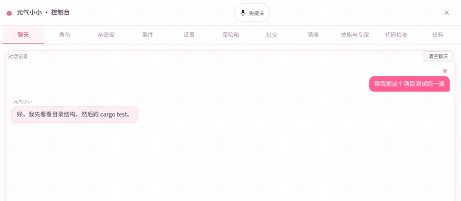
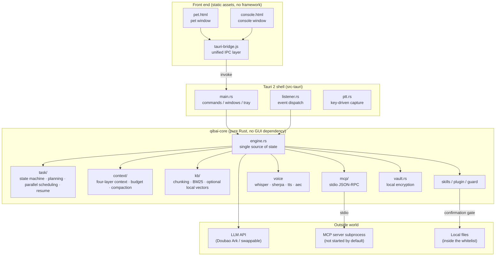
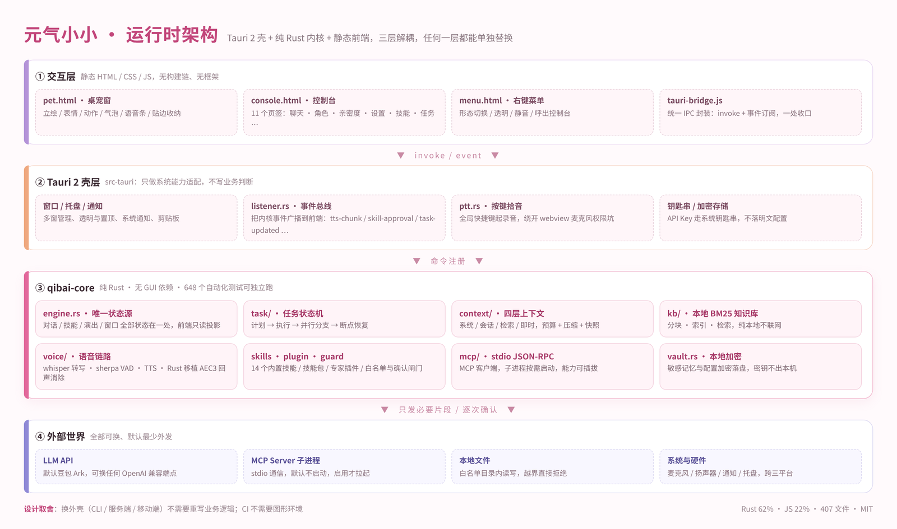
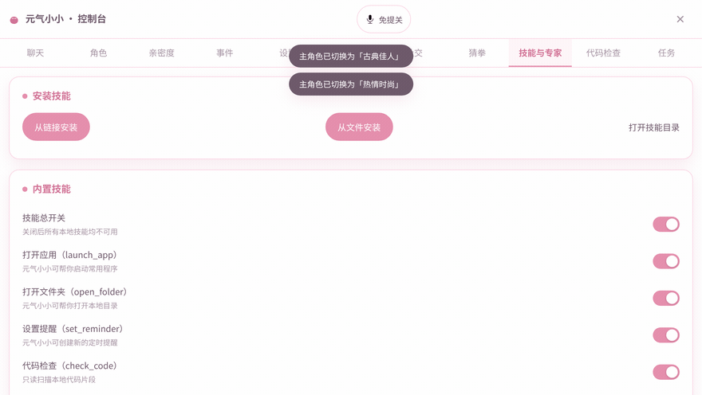
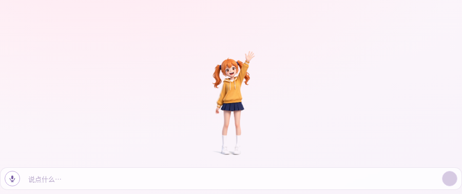
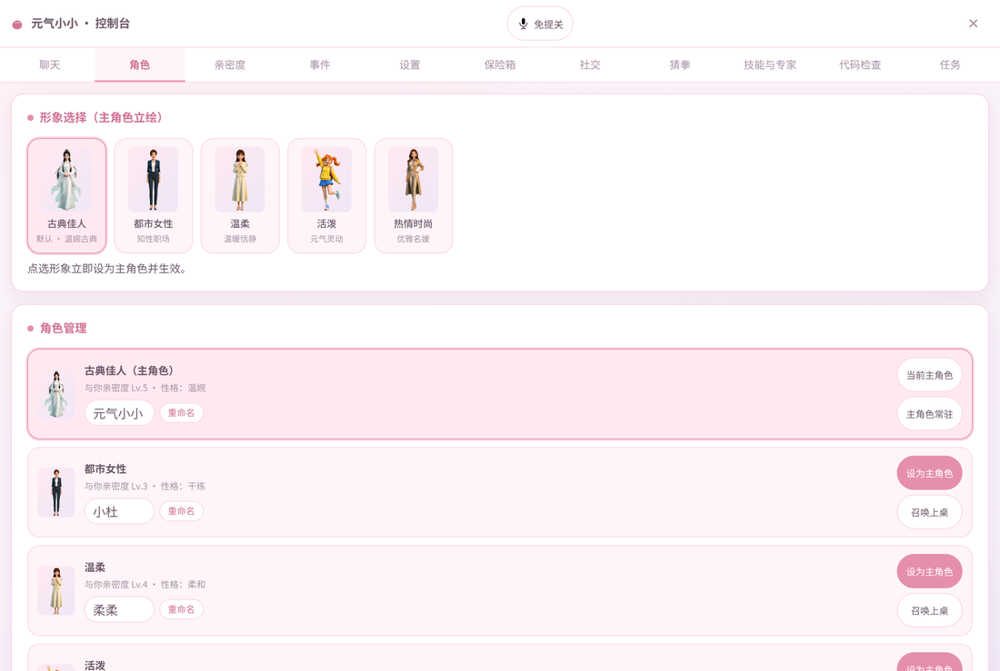
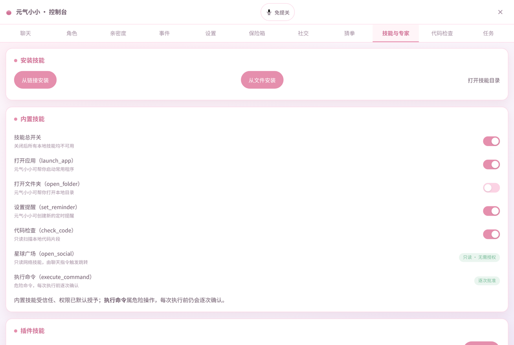
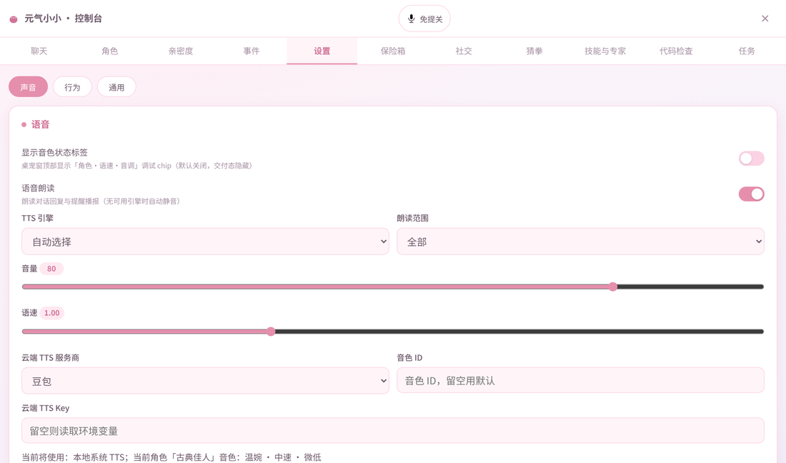

<div align="center">

# Qibai · 元气小小

**An AI companion living in the corner of your desktop — it chats, it remembers, and it actually does the work. Local-first desktop AI.**

Pet window + console window ｜ Tauri 2 + pure-Rust core ｜ Windows / macOS / Linux

**English** ｜ [简体中文](README.md)

[](LICENSE)
[](https://tauri.app)
[](https://www.rust-lang.org)
[](#quick-start)
[](https://github.com/AllenD87/qibai/actions/workflows/ci.yml)

<br/>



<br/>
<sub><b>Real footage</b>: recorded from the actual front-end — chat / characters / intimacy / events / settings / skills &amp; experts / code check / tasks. Click through and it's the real UI.</sub>

</div>

---

## What is this

Qibai (元气小小, internal codename **qibai**) is **an AI companion that lives in the corner of your desktop** — a little character that chats, remembers, and **actually gets things done**.

Say "小小" (Xiaoxiao) and it starts listening. Say "get this project running" and it really creates the directories, writes the README, and runs the tests. When you've been heads-down for too long and forget to drink water, it shows up on its own to remind you.

It is not "a chat window with a new skin", and it is not "an API wrapped in a popup".


<div align="center">
<b>It chats · It listens · It remembers · It acts</b>
</div>

---

## Three highlights, 30 seconds

| It chats: a stateful desktop pet | It listens: speech really runs locally | It acts: it finishes the job for you |
|---|---|---|
| 5 characters, each with its own look, personality, intimacy and voice<br>Expressions and motions driven by structured LLM output<br>Proactive nudges for sitting too long, hydration, eye rest<br>Tired of talking? Play a round of rock-paper-scissors | Local whisper transcription — audio never leaves the machine<br>Say the wake word for hands-free mode, VAD splits sentences<br>**Barge-in supported**: talk over it while it speaks<br>Rust-ported AEC3, so it never hears itself | **14 built-in skills**: scaffold projects, read/write files, run tests, check code, search, fetch pages, launch apps<br>Skill packs / expert plugins / MCP / HTTP connectors all plug in<br>**Risky actions confirmed one by one** — no confirmation, no execution |

---

## 30 seconds: you say it, it does it

| You say | It does |
|---|---|
| "Xiaoxiao" | Enters hands-free listening; VAD splits sentences; answers as soon as you stop |
| "Have the tests passed on this project?" | Calls `git_status` / `run_tests` / `code_scan` and reads you the real result |
| "Scaffold a Rust project called demo" | `create_project`: directory skeleton + README + `.gitignore` + `PROJECT.md`, optional `git init` |
| "What's wrong with this code?" | `check_code` read-only analysis, returning **file + line + problem + suggested fix** |
| "Search the Tauri 2 tray API for me" | `web_search` to find it, `fetch_page` to read the full page, then answers from the real page |
| "Remind me to drink water in ten minutes" | `set_reminder`: on time — system notification + pet bubble + speech |
| "I'm kind of tired" | Switches expression and motion; if needed pulls up the full-screen guardian scene to make you rest |
| "Save this config into my docs" | `file_ops` writes the file, but only inside `~/Documents/qibai` — anything outside is **refused outright** |

### Capability overview: six things, none skipped

| Capability | What it actually is | Details |
|---|---|---|
| **Companionship** | 5 characters (independent look / personality / voice / intimacy) + expression & motion performance + proactive sit-too-long, hydration and eye-rest reminders + rock-paper-scissors + full-screen guardian scene | Features · 1 |
| **Voice** | Hold a global hotkey to talk → local whisper transcription → streaming reply → segmented speech; wake word for hands-free, VAD splitting; **barge-in** any time | Features · 2 |
| **Actions** | 14 built-in skills: scaffold projects, read/write files, run tests, check code, search, fetch pages, launch apps, set reminders… each toggleable in the console | Features · 3 |
| **Extensions** | Skill packs (pack / import / install), expert plugins, MCP servers (stdio), HTTP connectors — install at runtime, no need to touch the main binary | Features · 3 |
| **Memory** | Four-layer context (system / session / retrieval / immediate) + auto compaction + local knowledge base (BM25 plus optional local semantic vectors, add folders, rebuild index) + local encrypted vault | Features · 4 |
| **Guardrails** | Whitelisted directories + per-action confirmation for risky operations + no MCP subprocess by default + zero secrets in the code + all-ages content | Features · 5 + [Privacy & security boundaries](#privacy--security-boundaries) |

## Feature deep dive

### 1. Companionship: a stateful desktop pet

- **5 characters**: Classic, Urban, Gentle, Lively, Chic. Look, personality, voice and intimacy are all independent, switchable from either the pet window or the console.
- **Expressions and motions are not random playback**: the LLM returns structured output (text / expression / motion / skill), and that decides whether it smiles, tilts its head, or waves — so the performance actually fits.
- **Bubbles never get in your way**: short lines auto-collapse after 4 seconds, long ones stay. Both bubbles and standalone panels go through HTML sanitisation.
- **It speaks up first**: three reminder classes (sitting too long, hydration, eye rest) fire a system notification + pet bubble + speech; "remind me in ten minutes" works too.
- **It makes you rest**: a full-screen guardian scene where the character walks to the middle of your screen and asks you to get up and move — dismissible at any time.
- **It has intimacy**: grows as you talk; higher levels unlock more reactions, and the console shows the real numbers.
- **Right-click to manage it**: switch character / lock position / guard me / transparent background / full UI / open console / quit.
- **And a round of rock-paper-scissors**: a small game in the console. Lose and it will laugh at you.

<sub>Implementation: `persona.rs` `personas.rs` `intimacy.rs` `reminder.rs` `guard.rs` `panel.rs` `src/pet.html` `src/menu.html`</sub>

### 2. It listens: the speech pipeline genuinely runs locally

- **Two ways to talk**: hold-to-talk (PTT), or say the wake word to enter hands-free mode and let it split sentences for you.
- **Local transcription**: `whisper.cpp` runs as a resident service; audio never leaves the machine, and Chinese can switch to sherpa paraformer. Nothing is uploaded — this is the fundamental difference from "cloud voice assistants".
- **VAD sentence splitting**: no need to click stop; a pause ends the sentence, and long utterances are still captured.
- **Barge-in**: talk while it is reading and it stops immediately to listen — not "wait for it to finish, then queue".
- **Echo cancellation**: a pure-Rust port of WebRTC AEC3, using the playback reference signal, so loudspeaker output does not self-oscillate and it never talks to itself.
- **Swappable speech output**: local piper / espeak-ng as fallback, or cloud Doubao TTS; 5 characters with 5 voices; streaming, speaking while generating.

<sub>Implementation: `whisper_engine.rs` `sherpa_engine.rs` `tts.rs` `aec.rs` `audio_pulse.rs` `realtime_voice_frontend.rs`</sub>

### 3. It acts: 14 built-in skills plus an extensible ecosystem

| Skill | What it does | Permission |
|---|---|---|
| `launch_app` | Open a local application by name | Whitelist |
| `open_folder` | Open a given folder | Whitelist |
| `file_ops` | Read / write / list directories | `~/Documents/qibai` only |
| `create_project` | Scaffold four-language projects (python / node / rust / web): `src/`, `config/`, README, `.gitignore`, entry file, `PROJECT.md`, optional `git init` | Whitelist |
| `project_context` | Read `PROJECT.md` and remember goals, progress and decisions across sessions | Read-only |
| `git_status` | Repo status, changes, branches | Read-only |
| `run_tests` | Run project tests and parse the results | Per-action approval |
| `code_scan` | Whole-project scan for suspicious spots and code smells | Read-only |
| `check_code` | Single-file check returning **file + line + problem + fix** | Read-only |
| `web_search` | Web search (engine, result count and timeout configurable) | On by default |
| `fetch_page` | Fetch a page's body before answering, instead of guessing from search titles | On by default |
| `set_reminder` | Create / cancel timed reminders | Safe |
| `open_social` | Open anonymous social (read-only browsing) | Read-only, no auth needed |
| `execute_command` | Run shell commands | **Per-action approval** |

**And it grows beyond those 14:**

- **Skill packs**: a `qibai-plugin.json` plus scripts zipped together; import in the console and it's installed — no rebuilding the main binary.
- **Expert plugins**: one persona prompt + one skill whitelist + voice/look binding. Install a "code review expert" and it only gets the code-reading tools, and speaks in a different register.
- **MCP**: a standard stdio JSON-RPC client, external tools uniformly named `mcp__<server>__<tool>`; **the default config is empty, so zero subprocesses start**.
- **Custom connectors**: fill in one entry in the console to add a capability — `Mcp` (command + args) or `Http` (POST url + headers) — and it materialises into a plugin at runtime.
- **Screen capability (off by default)**: screenshot understanding plus coordinate clicking under tiered authorisation; screen content is used for understanding only, and **actions must be triggered by your voice command or your own click**, isolating prompt injection by design.

<sub>Implementation: `skills.rs` `skill_pack.rs` `skill_install.rs` `expert.rs` `connectors.rs` `mcp/` `screen.rs` `src-tauri/src/screen_gui.rs`</sub>

### 4. It remembers: context that never blows up, a knowledge base that never leaves, tasks that resume

- **Four-layer context**: L0–L3 layering + token budget + auto compaction + snapshots. Chat all day without going mushy, forgetting, or crashing.
- **Layered memory**: core rules > assistant profile > explicit preferences > long-term memory — the earlier the layer, the less it can be overridden.
- **Local knowledge base**: directory-level indexing + chunking + BM25 retrieval; add a 512-dim local vector model (bge-small-zh-v1.5) and it upgrades to hybrid keyword + semantic search — ask "my computer is getting slow" and it still hits the passage that says "the machine runs slower and slower". Once indexed, conversations cite the hits automatically (only those close to the top, so no dilution). The vector model downloads on demand (~91 MB, one click in-app, not shipped in the installer); pure BM25 keeps working without it. **Indexing, embedding and retrieval all run on your machine — not a single byte of text leaves it.**
- **Task orchestration**: planned long-running tasks — propose a plan first, wait for your nod on risky steps, pausable and resumable; subtasks run in parallel along a dependency graph (concurrency limit configurable); when something goes wrong you can re-run the whole task or restart from a given step.
- **Project memory**: `PROJECT.md` records goals / requirements / technical approach / progress / decisions, `projects.json` keeps the project list, so "continue the one from last time" just works.

<sub>Implementation: `context/` `memory_layers.rs` `kb/` `task/` `project_context.rs` `project_scaffold.rs`</sub>

### 5. The security bits, handled by default

- **Password vault**: AES-GCM + PBKDF2 local encryption, key can be handed to the OS keychain; no plaintext on disk.
- **Anonymous social (optional)**: same-city plus planet-style anonymous matching, fully offline by default; to use it, self-host `server/` (Node + WS + SQLite).

---

## How it differs from typical "AI desktop pets"

| Dimension | The usual approach | Qibai |
|---|---|---|
| **Architecture** | Business logic inside Tauri commands; change the shell and rewrite everything | A pure-Rust core crate with no GUI dependency — testable and evolvable on its own |
| **Testing** | Click through it manually | **666 automated tests** in the core library (`cargo test -p qibai-core`): 656 pass on a clean checkout, 7 need the local speech bundle / whisper model (not shipped in the repo), 3 are ignored by default |
| **Voice** | Everything delegated to a cloud API | Local whisper transcription + local TTS fallback; cloud is just an option |
| **Permissions** | The model does whatever it wants | Off by default + whitelist + **per-action confirmation** for risky steps; out-of-bounds is refused |
| **Context** | Dump everything into one prompt | Four layers + budget + compaction + snapshots |
| **Extensions** | Adding a feature means patching the main binary | Skill packs / experts / MCP / HTTP connectors, plugged in at runtime |
| **Large files** | Everything committed, a clone costs hundreds of MB | Models and artwork go through scripts and Releases; the repo is about 20 MB |

---

## Architecture



### Why it is split into three layers

| Layer | Responsibility | Why it is its own layer |
|---|---|---|
| **`qibai-core`** | All business logic: state machine, context, knowledge base, voice, tasks, tools | Pure Rust, no GUI dependency → `cargo test` runs directly, and CI needs no graphics stack; a future shell (Tauri / CLI / server) reuses the logic unchanged |
| **`src-tauri`** | Windows, tray, hotkeys, system notifications, clipboard, keychain | System capability adaptation only — no business judgement |
| **`src/`** | Static HTML/CSS/JS front end | No build chain, no framework; edit a line and refresh — lowers the barrier to contribution |

`src-tauri` deliberately **carries its own `[workspace]`**: so a root-level `cargo test` compiles only the core library and never drags in system libraries like webkit2gtk, which keeps CI green on all three platforms.



### Looking ahead: five things already shipped

Not nouns on a roadmap — code in this repo that runs and is tested today.

| Direction | What is already done | Why it counts as forward-looking |
|---|---|---|
| **Kernel and shell fully separated** | `qibai-core` is pure Rust with zero GUI dependencies; 656 tests run without a graphics environment (7 more need local speech assets) | Changing shells costs nothing: Tauri today, CLI / server / mobile tomorrow — not one line of business logic changes |
| **LLM output as "structured performance"** | The model returns a 4-tuple at once: **text / expression / motion / skill**, which the kernel turns into a performance queue and tool calls | Makes "acting convincingly" data that can be composed, replayed and tested, instead of random sprite swaps |
| **Four-layer context + budget compaction + snapshots** | System / session / retrieval / immediate layering, auto compaction over budget, session state restorable from snapshot | Long conversations never blow the window or lose the setup, and interrupted tasks resume |
| **Local voice stack + barge-in** | Local whisper transcription, sherpa VAD sentence splitting, Rust-ported AEC3 echo cancellation | You can interrupt while it speaks; audio stays on the machine and needs no cloud speech API |
| **Runtime-pluggable extension contracts** | Skill packs / expert plugins / stdio MCP / HTTP connectors — install and use, no main-binary rebuild | Capabilities are composable plugins, not if-else branches baked into the source |

Three engineering ground rules come with it: **per-action confirmation for risky operations**, **whitelisted file writes**, **minimal outbound by default** — being forward-looking is not the same as handing over the keys.

> Still in progress, not merged yet: Doubao Work / Feishu office integration (the `doubao_work.rs` architecture hook exists), multiple characters on stage at once. The README never counts planned capability as shipped capability.

---

## Repository layout

```
qibai/
├── qibai-core/                 # ★ pure Rust core, all business logic
│   └── src/
│       ├── engine.rs           #   single source of state and the public entry point
│       ├── task/               #   task state machine / planning / parallel scheduling / resume
│       ├── context/            #   four-layer context / budget / compaction / snapshots
│       ├── kb/                 #   local knowledge base (chunking / BM25 / optional local vector hybrid retrieval)
│       ├── mcp/                #   MCP stdio client / registry / bridge
│       ├── tts.rs  whisper_engine.rs  sherpa_engine.rs  aec.rs
│       ├── skills.rs  plugin_registry.rs  guard.rs  codecheck.rs
│       ├── vault.rs  intimacy.rs  netsocial.rs  reminder.rs
│       └── settings.rs  storage.rs  llm_client.rs
├── src-tauri/                  # Tauri 2 shell (its own workspace)
│   └── src/ main.rs  listener.rs  ptt.rs  screen_gui.rs
├── src/                        # static front-end pages
│   ├── pet.html / pet.js       #   pet window
│   ├── console.html / console.js  #  console window
│   ├── panel.html  menu.html  guard.html
│   └── tauri-bridge.js         #   the front end's only IPC exit
├── server/                     # optional: Node networking/social server (HTTP + WS + SQLite)
├── plugins/                    # skill / expert plugin definitions
├── tests/                      # integration tests and fixtures
├── scripts/                    # build, package, verification scripts
├── docs/                       # architecture and contract documents
├── .github/workflows/          # CI
├── fetch_resources.sh          # one-shot fetch of large resources (models / whisper binary / speech)
└── Cargo.toml
```

---

## Quick start

### 1. Prerequisites

**All platforms**: Rust 1.75+ (install with `rustup`), Git.

**Linux** (Debian / Ubuntu family):

```bash
sudo apt install -y \
  libwebkit2gtk-4.1-dev libsoup-3.0-dev libjavascriptcoregtk-4.1-dev \
  libgtk-3-dev librsvg2-dev build-essential pkg-config \
  libayatana-appindicator3-dev          # tray icon runtime
```

**macOS**: `xcode-select --install`
**Windows**: MSVC toolchain (`rustup default stable-msvc`) + WebView2 (bundled with Windows 11)

### 2. Fetch the large resources (required)

Models, the STT binary and offline speech **are not in the repo**. Pull them with the script:

```bash
bash fetch_resources.sh
```

It downloads:
- the whisper.cpp binary → `src-tauri/whisper-bin/`
- the Chinese STT model → `src-tauri/models/ggml-small.bin` (swap to a smaller model with `QIBAI_WHISPER_MODEL=ggml-base.bin`, 142 MB)
- and checks whether `espeak-ng` is installed (local TTS fallback)

Everything comes from upstream official releases / HuggingFace, and the script is idempotent.

**Character artwork and motion frames** (120 PNGs across five characters, 478 MB) are also kept out of the repo and pulled from Release volumes:

```bash
bash fetch_personas.sh     # download 3 volumes → md5 verify each → concatenate → extract into src/assets/personas/
```

Takes about a minute and is idempotent (skips if already installed). It also starts without them, but the pet would show blank sprites.

### 3. Run the tests

```bash
cargo test -p qibai-core          # core library unit tests (tasks / context / KB / MCP …)
cargo test -p qibai-core --test mcp_transport   # MCP transport layer (ships its own echo server)
```

### 4. Build and run

```bash
cd src-tauri
cargo build --release
# artifact: target/release/qibai-tauri
```

To package an installer (install `cargo-tauri` first):

```bash
cargo install tauri-cli --version "^2"
cargo tauri build
```

### 5. Configure the API key

On first launch, open the console → Settings and enter your LLM API key (Doubao Ark by default; any OpenAI-compatible endpoint works). **The key stays local — never committed, never logged.**

---

## Privacy & security boundaries

Please read this section: it decides whether you can put this on your own machine with a clear conscience.

| Item | Current behaviour |
|---|---|
| **Data storage** | Conversations, settings, memory and tasks all live in the local data directory; no sync, no upload |
| **What leaves the machine** | Only the text necessary for a conversation you explicitly trigger goes to the LLM; the key is yours |
| **File operations** | Whitelist by default — only paths under `~/Documents/qibai` are readable/writable, anything else is refused |
| **Risky operations** | Writing files / running commands / calling external tools go through a confirmation gate; unconfirmed means **not executed**, and every attempt is recorded |
| **MCP external tools** | Empty default config → **no subprocess started**; once enabled, every call still needs confirmation and is labelled `MCP / <server>` |
| **Screen and input** | Screenshot / GUI-control capability is off by default and needs explicit authorisation |
| **No secrets in code** | No hardcoded keys anywhere in the repo; `.env.example` lists field names only, all values empty |
| **Compliance** | All-ages content with a built-in age check and pure mode; no suggestive assets |

Found a security issue? Use **Security → Private vulnerability reporting** — please don't open a public issue.

---

## Known limitations

- **Local-first ≠ fully offline**: conversation needs an LLM; offline you still get reminders, pet performance and local knowledge-base retrieval.
- **Speech quality depends on hardware**: echo cancellation is tuned for common loudspeaker setups; very high output volume or unusual sound cards may leave residue.
- **Models are downloaded separately**: no weights in the repo (both size and licensing), so `fetch_resources.sh` is required on first run.
- **Networking/social is optional**: `server/` needs Node ≥ 22.5 with built-in `node:sqlite`, and is off by default; with no server address configured the client is entirely local.
- **Uneven platform coverage**: Windows / macOS are the primary verification targets; Linux needs a fairly recent webkit2gtk 4.1 and some distributions require installing the runtime yourself.
- **Artwork is not in the repo**: see [`docs/ASSETS.md`](docs/ASSETS.md) and get it from the Release attachments.

---

## Interface gallery: GIFs and screenshots

**Video**: [Qibai demo on WeChat Channels](https://weixin.qq.com/sph/AZdiIWOvIU) (opens inside WeChat)

### GIF 1 · Pet window: bubble chat → expression performance → live character swap

Three things happen in one window: the bubble finishes the sentence, the character performs a reply, and one click swaps the character on the spot.

<div align="center">

</div>

### GIF 2 · Console: 11 tabs at a glance

Chat, characters, intimacy, events, settings, vault, social, rock-paper-scissors, skills & experts, code check, tasks — not ten empty pages; every one has a real implementation behind it.

<div align="center">

</div>

### GIF 3 · Characters: click to switch — look / personality / voice / intimacy all change together

<div align="center">

</div>

### GIF 4 · Skills & experts: capabilities toggled one by one, risky ones "approved per action"

`launch_app`, `open_folder`, `set_reminder` and `check_code` can be toggled at any time; `execute_command` is marked "per-action approval" and `open_social` "read-only · no auth needed".

<div align="center">

</div>

### Pet window (still)

The character stands in the corner of your screen, the bubble carries the reminder or the line, and the bottom is the voice input bar (hands-free and voice keys on the left, send on the right).



### Console · Characters

Five characters with independent looks, personalities and intimacy — switch or summon any of them at any time.



### Console · Skills & experts (the permission model)

Built-in skills toggle one by one; risky capabilities such as "run command" are marked "per-action approval" and still ask before every execution.



### Console · Settings (the speech pipeline)

The TTS engine switches between local and cloud; STT goes through local whisper, so speech never passes through a cloud service.



### The five characters


> All of the above are real screenshots of the running app: real front-end pages, real styling, real artwork. The full character art and motion frames are not in the repo — see [`docs/ASSETS.md`](docs/ASSETS.md).

---

## Contributing

Issues and PRs are welcome. Three ground rules:

1. **Tests must pass**: get `cargo test -p qibai-core` green before opening a PR.
2. **New capabilities ship off by default**: any new execution-type capability starts disabled, behind a whitelist and a confirmation gate.
3. **No large files in git**: anything over 5 MB per file goes through a Release or a download script.

See [`CONTRIBUTING.md`](CONTRIBUTING.md) for details. Report vulnerabilities privately via [`SECURITY.md`](SECURITY.md) — never in a public issue; taking part in discussions means you accept [`CODE_OF_CONDUCT.md`](CODE_OF_CONDUCT.md).

---

## License

- **Code**: MIT, see [`LICENSE`](LICENSE) (the file contains the plain MIT text so platforms can detect the licence automatically).
- **Artwork** (character art / motion frames / expressions): **not covered by MIT**; separately licensed, contact the author for commercial use — see [`docs/ASSETS.md`](docs/ASSETS.md).
- **Third-party components**: whisper.cpp, sherpa-onnx, piper, espeak-ng and others carry their own licences — see [`THIRD-PARTY-NOTICES.md`](THIRD-PARTY-NOTICES.md) (including the bge-small-zh-v1.5 vector model and tract-onnx).

---

<div align="center">

<sub>Qibai · 元气小小 — a desktop companion willing to actually do the work for you</sub>

<sub>Author: 燕南狂徒 (Yannan Kuangtu) ｜ <a href="tel:15712751280">15712751280</a> ｜ <a href="mailto:alunupc@126.com">alunupc@126.com</a></sub>

<sub>Repository: <a href="https://github.com/AllenD87/qibai">github.com/AllenD87/qibai</a></sub>

</div>
